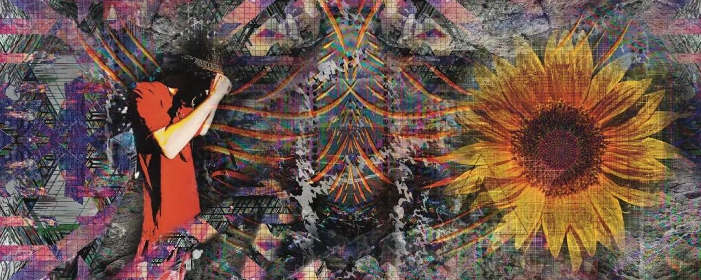
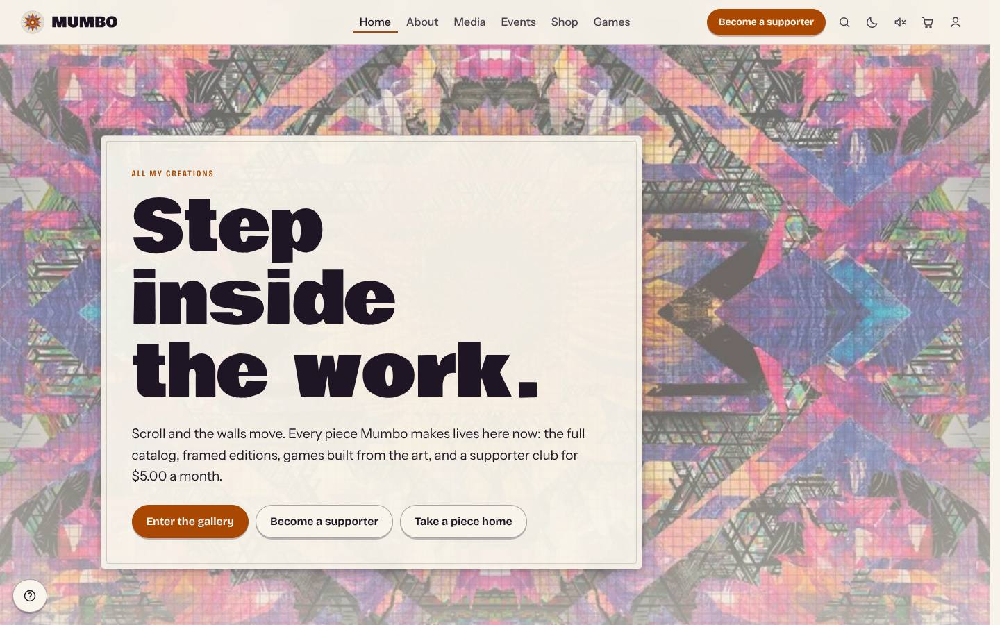
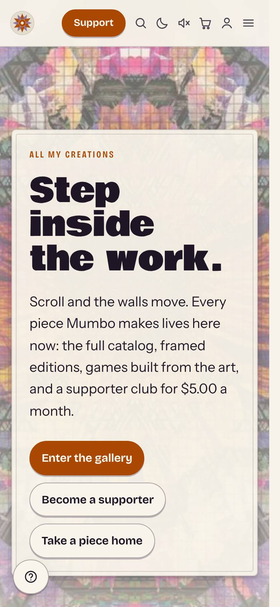

  

<h1 align="center"><a href="https://mumbotopia.com">Mumbo Vibes</a></h1>

The home of Mumbo's art: psychedelic glitch collage, sketchbook ink and paint on canvas, all in one place he owns. The site itself is part of the work, a living surface that shifts and throws holographic light as you scroll. Walk the gallery, take home a framed edition, play games built from the pieces, or join the supporter club.

<strong>Live site:</strong> <a href="https://mumbotopia.com">mumbotopia.com</a>

  <a href="#what-it-is">What it is</a> · <a href="#features">Features</a> · <a href="#book-or-get-in-touch">Contact</a> · <a href="#connected-brands">Connected brands</a> · <a href="#credits--contact">Credits</a>

<table>
  <tr>
    <td align="center" valign="top"> Desktop: the home page, laid over Mumbo's glitch work.</td>
    <td align="center" valign="top"> Mobile: the same page on a phone.</td>
  </tr>
</table>

## What it is

Mumbo Vibes is the official site of Mumbo (Conner Vaught), built so his whole catalog lives in one place he owns. Every page sits on top of the art itself. Anything laid over it is styled as printed matter: poster titles, pieces hung as framed plates, memberships as tickets, coins that look minted.

It is a portfolio, a shop, a members' club and a small arcade in one, built and hosted by Zathena Ventures.

## Features

### The experience
- **Living background**: scrolling dives through the pieces, and the surface keeps breathing and shifting while you stand still.
- **Entrance doors**: a first visit opens on a pair of doors cut from one piece. Walk in quietly or with sound.
- **Holographic foil**: reach for a piece, a ticket or a door and a foil sheen follows your hand.
- **Soundtrack**: a MIDI loop plays across the site once you turn sound on, with the visuals pulsing to it.
- **Day and night modes**: each with its own favicon.
- **Accessibility menu**: text sizing, contrast, color-vision filters and reduced motion.

### The catalog
- **[Gallery](https://mumbotopia.com/gallery/)**: every series in its own wing, [glitch](https://mumbotopia.com/gallery/?c=glitch), [sketch](https://mumbotopia.com/gallery/?c=sketch) and [paint](https://mumbotopia.com/gallery/?c=paint), each with its own wall text.
- **Wall labels**: every piece hangs on a mat in its frame, whatever its shape, with the framed edition offered beside it.
- **[Events](https://mumbotopia.com/events/)**: shown as a run of gig tickets.
- **[Press](https://mumbotopia.com/media/featured-in/)**: dated clippings, newest first, plus the [music](https://mumbotopia.com/media/music/) as a track sheet and an [exhibition](https://mumbotopia.com/media/exhibition/) page.
- **[Posts](https://mumbotopia.com/posts/)**: the process behind the work, with comments, likes and replies.
- **[Links hub](https://mumbotopia.com/links/)**: every profile in one place, each shareable to the major platforms.

### The club
- **[Membership](https://mumbotopia.com/membership/)**: free and supporter tiers. One supporter membership opens supporter pieces, posts, games and merch together.
- **Supporter previews**: supporter releases sit behind a curtain that still shows you what you are missing.
- **Mumbo Coins**: an arcade currency earned by playing, doubled for supporters.
- **Self-serve billing**: members change their card, review past payments, resend any receipt, and cancel or undo a cancel from their account page. A cancel runs to the end of the period already paid.

### The shop
- **[Shop](https://mumbotopia.com/shop/)**: framed editions, apparel and stickers, with filters and search.
- **Receipt-style cart**: the cart reads like a receipt, on its own page and in a side sheet, and holds promo codes while you browse.
- **Shipping**: a flat rate under $60 and free shipping from $60.
- **On-site checkout**: email, shipping and card on one dialog, with every line, shipping and the fee shown before you pay. Receipts come from the site itself.
- **Order history**: every order in your account with its date, items, total and status.

### The arcade
- **[Games](https://mumbotopia.com/games/)**: [Match](https://mumbotopia.com/games/match/), Slide, [Color](https://mumbotopia.com/games/color/) and [Jigsaw](https://mumbotopia.com/games/jigsaw/), all built from the artwork, with bigger boards at higher levels.
- **[Coin store](https://mumbotopia.com/games/coins/)**: upgrades sold as tickets priced in coins.
- **Play your way**: every game works by keyboard as well as touch. Level one of each is open to everyone.

## Book or get in touch

For questions or messages, use the [contact page](https://mumbotopia.com/contact/). Answers to common questions are on the [FAQ](https://mumbotopia.com/faq/).

## Connected brands

- [Zathena Ventures](https://zathenaventures.xyz): built and hosted by. Repo: [ZathenaVentures-Public](https://github.com/ZATHENA-VENTURES/ZathenaVentures-Public).

## License

© 2026 Mumbo (Conner Vaught). All rights reserved.

## Credits & Contact

- **Art:** Mumbo
- **Live site:** [mumbotopia.com](https://mumbotopia.com)
- **Contact:** [mumbotopia.com/contact](https://mumbotopia.com/contact/)
- **Built and hosted by:** [Zathena Ventures](https://zathenaventures.xyz)

> This is the public showcase of a private repository. It presents the project, its features and its live site, and leaves out source code and deployment details.
